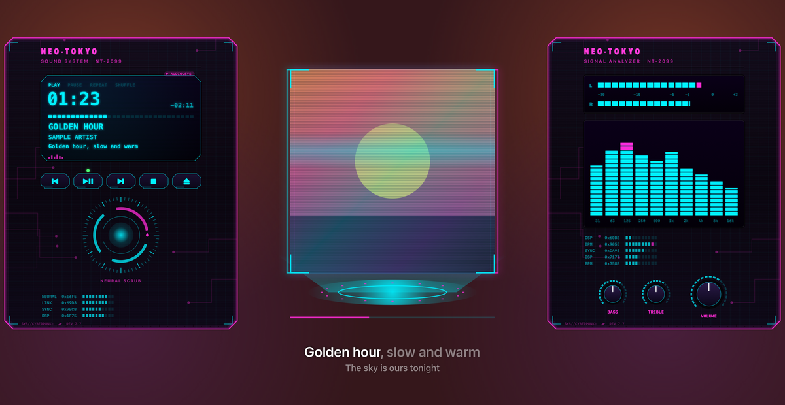

# Himawari — project page

The public page and downloads for **Himawari**, a live video wallpaper for macOS that turns into
your music: **[dhairyab0069.github.io/himawari-io](https://dhairyab0069.github.io/himawari-io/)**.

- **Download:** the latest DMG is on the [Releases](https://github.com/dhairyab0069/himawari-io/releases/latest) page
  (macOS 14.4 or newer, Apple silicon and Intel). The first time, right-click ▸ Open: it isn't notarized yet.
- **Source code:** [dhairyab0069/himawari-mac](https://github.com/dhairyab0069/himawari-mac), with the
  [roadmap](https://github.com/dhairyab0069/himawari-mac/blob/main/ROADMAP.md) and
  [release notes](https://github.com/dhairyab0069/himawari-mac/tree/main/docs/release-notes).

## What Himawari does

- **Live wallpaper:** any `.mp4` or `.mov`, paused when nobody can see it.
- **The music wallpaper:** while a song plays (Apple Music, Spotify, TIDAL, Amazon Music, Deezer, web
  players), the album's animated cover becomes the desktop. Songs without one get their cover on the
  style's media: a record, a cassette in front of its case, a picture CD, a floating card, a game
  cartridge or a hologram.
- **Gear from every era**, beside the cover, playable and with meters that follow the real music: a
  1970s receiver, a 1980s tape deck, a 1990s portable, the 2000s CD rack, a pocket player on its dock,
  today's glass panes. Fourteen skins, looks that follow the genre or the cover's colours, and a
  Customise window with live previews.
- **Synced lyrics** (Beta 1.5): the line being sung on the gear's display, and big under the cover
  with a karaoke sweep. From [LRCLIB](https://lrclib.net), or Apple Music's own lyrics.
- **Make your own:** skins are small JSON files, and design files lay out whole new eras from blocks.
  Both reload as you save. [Make your own look](https://github.com/dhairyab0069/himawari-mac/blob/main/docs/make-your-own.md)
  walks through a cyberpunk one step by step.
- **And:** a desktop clock, click-to-hide desktop files, the disc changer for playlists, and a moving
  lock screen.

## What's in this repo

| Path | What it is |
|---|---|
| `index.html` | The whole page (one file, no build step), served by GitHub Pages from `main` |
| `assets/` | Its pictures: GIFs recorded on a Mac, and the style pictures rendered by Himawari (`Himawari --render-styles`) |
| `media-src/` | Sources for the recordings |
| `release/<version>.sed` | Page edits applied on release day, if a release needs any |

Releases are made from the app repo by `scripts/release.sh`. It builds the DMG, publishes the release
here and in himawari-mac, and points this page's download links and version badge at the new DMG.
